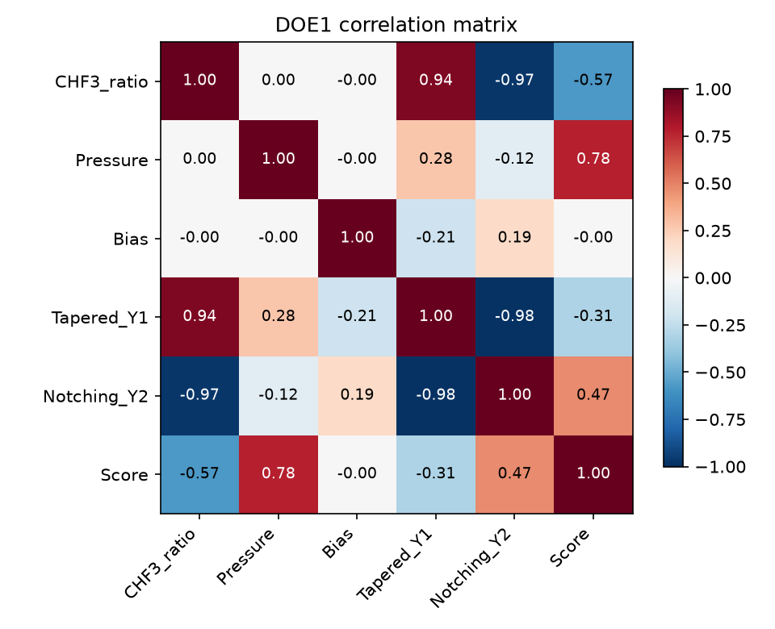
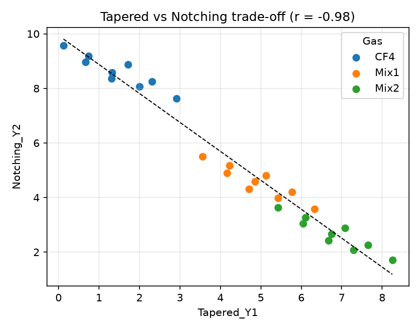
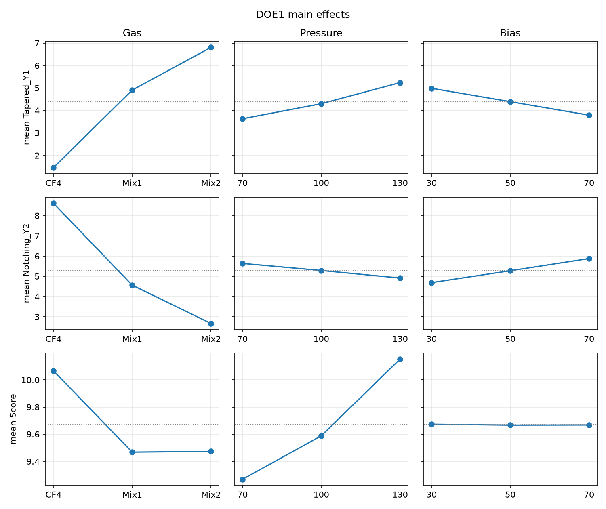
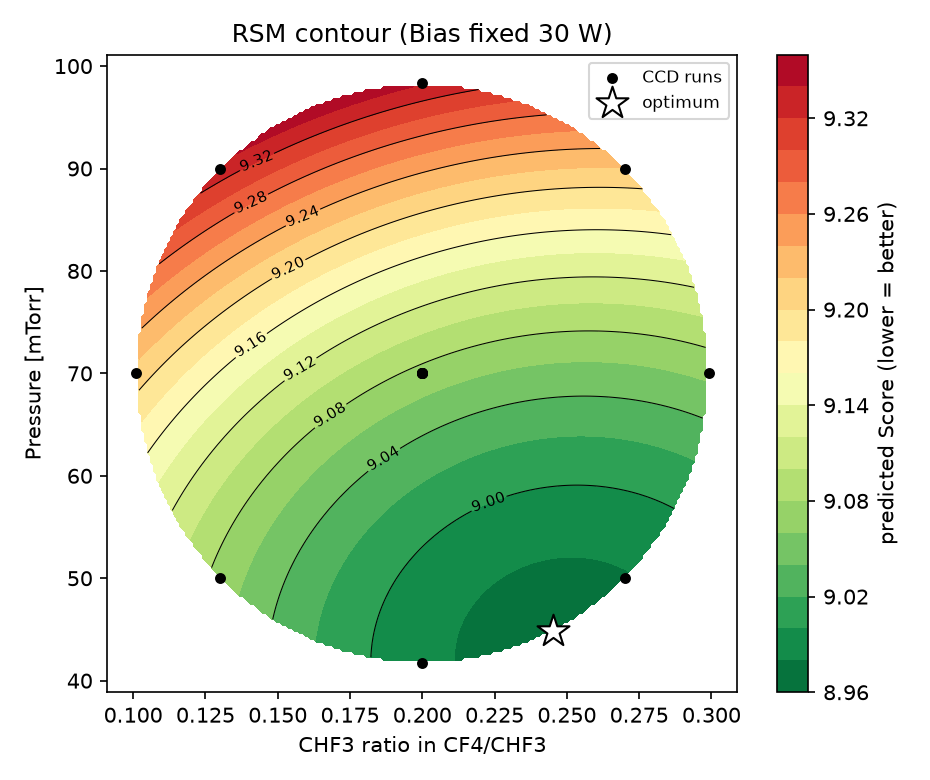
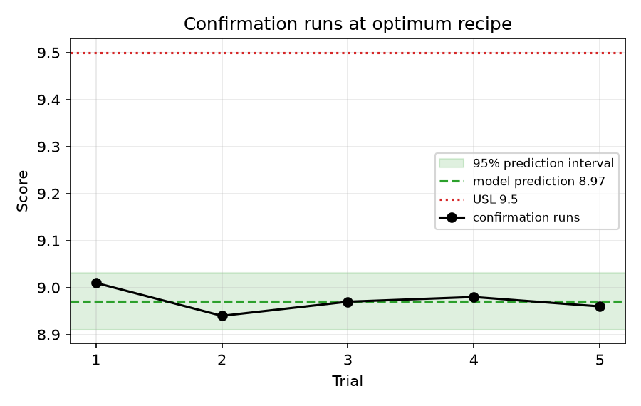

# Dry Etching Defect 개선 — DOE 자동 분석 보고서

> ⚠️ 본 데이터는 실측값이 아닌 **참고용(가상 공정) 데이터**입니다. 실측 SEM 판독값을 `data/*.csv`에 넣으면 동일 파이프라인이 그대로 재실행됩니다.

- 실행 시간: **1.9 s** (전처리 · 상관 · ANOVA · 회귀 · RSM · 확인실험 · 보고서 일괄)
- 통합 불량 Score = Tapered_Y1 + Notching_Y2 (0~10 등급 합, 낮을수록 양호)

## 0. 문제 정의 및 가설

- **현상**: 현 공정(CF4 단독 / 100 mTorr / 50 W)에서 상부 CD > 하부 CD인 **Positive Taper**와 etch stop 계면 하부 측벽이 파이는 **Bottom Notching**이 동시에 발생
- **메커니즘**: 라디칼(화학 식각) · 이온(방향성 식각) · CFx 폴리머(측벽 패시베이션)의 균형 붕괴. 패시베이션이 과하면 Taper, 이온 편향·보호막 부족이면 Notching → 두 불량은 trade-off
- **가설**: Gas 조성(CF4:CHF3), Pressure(이온 직진성), Bias Power(이온 에너지)가 핵심 인자
- **전략**: 1차 완전요인 DOE로 인자 선별 → 유의 인자만 2차 RSM으로 연속 최적점 탐색 → 확인실험

## 1. 결론 요약

| 구분 | Gas (CF4 : CHF3) | Pressure | Bias | Score |
|---|---|---|---|---|
| 현 공정 | 100 : 0 | 100 mTorr | 50 W | 9.91 |
| 개선 Recipe | 75.5 : 24.5 | 44.8 mTorr | 30 W | 8.97 (확인실험 평균) |

- 확인실험 기준 Score **9.5% 감소**
- 모델 예측 8.97, 95% 예측구간 [8.91, 9.03] — 확인실험 전부 구간 내 (t-test p = 0.941)

## 2. 1차 DOE — 핵심 인자 판단 (27 runs)

### 2-1. 상관분석

Tapered와 Notching의 상관계수 **r = -0.985** (p = 1.39e-20) → 한쪽을 줄이면 다른 쪽이 늘어나는 trade-off. 단일 불량이 아닌 통합 Score로 최적화해야 함.

### 2-2. 주효과도

### 2-3. ANOVA (Score, 범주형 3인자)

| index | df | sum_sq | F | p_value | eta_sq |
|---|---|---|---|---|---|
| C(Gas) | 2 | 2.132 | 696.6 | 3.221e-19 | 0.3694 |
| C(Pressure) | 2 | 3.61 | 1179 | 1.765e-21 | 0.6253 |
| C(Bias) | 2 | 0.0002296 | 0.07502 | 0.928 | 3.978e-05 |
| Residual | 20 | 0.03061 |  |  | 0.005302 |

- Tapered_Y1: Bias p = 2.33e-27, Gas p = 1.80e-40
- Notching_Y2: Bias p = 9.87e-29, Gas p = 7.24e-43

**판단**: Score 기준 유의 인자(α = 0.05) = Gas, Pressure. Bias는 p = 0.928로 Score에는 유의하지 않음 — 개별 불량에는 영향이 있으나 Tapered를 줄이고 Notching을 늘려 **서로 상쇄**되기 때문. → Bias 30 W 고정, Gas 조성비 · Pressure만 2차 DOE로 진행.

### 2-4. 회귀분석 — Gas 변수 재정의

| 모델 | Gas 표현 | R² | adj R² | 최적점 탐색 |
|---|---|---|---|---|
| A (초기 자동생성 코드) | 1·2·3 범주 코드, 1차항 | 0.884 | 0.869 | 불가 (수준 사이 해석 불가) |
| B (재설계) | CHF3 비율 연속변수 + 2차항 | 0.979 | 0.975 | 가능 |

CF4 / Mix1 / Mix2는 CHF3 비율 0 → 0.2 → 0.3 위의 점이며 간격도 같지 않다. 범주 코드(1,2,3)로 넣으면 등간격·선형을 가정하게 되어 곡률(최적점)을 놓친다. 모델 B에서 2차항 p = 1.19e-06.

## 3. 2차 DOE — 반응표면분석 (CCD, 13 runs)

x1 = (CHF3 비율 − 0.2) / 0.07, x2 = (Pressure − 70) / 20, Bias = 30 W 고정

### 3-1. 실험 데이터

| Run | PointType | x1 | x2 | CHF3_ratio | Pressure | Tapered_Y1 | Notching_Y2 | Score |
|---|---|---|---|---|---|---|---|---|
| 1 | factorial | -1.000 | -1.000 | 0.130 | 50.000 | 3.170 | 5.920 | 9.090 |
| 2 | factorial | 1.000 | -1.000 | 0.270 | 50.000 | 5.740 | 3.250 | 8.990 |
| 3 | factorial | -1.000 | 1.000 | 0.130 | 90.000 | 3.890 | 5.450 | 9.340 |
| 4 | factorial | 1.000 | 1.000 | 0.270 | 90.000 | 6.520 | 2.700 | 9.220 |
| 5 | axial | -1.414 | 0.000 | 0.101 | 70.000 | 2.950 | 6.250 | 9.200 |
| 6 | axial | 1.414 | 0.000 | 0.299 | 70.000 | 6.650 | 2.410 | 9.060 |
| 7 | axial | 0.000 | -1.414 | 0.200 | 41.700 | 4.300 | 4.670 | 8.970 |
| 8 | axial | 0.000 | 1.414 | 0.200 | 98.300 | 5.360 | 3.980 | 9.340 |
| 9 | center | 0.000 | 0.000 | 0.200 | 70.000 | 4.740 | 4.340 | 9.080 |
| 10 | center | 0.000 | 0.000 | 0.200 | 70.000 | 4.760 | 4.310 | 9.070 |
| 11 | center | 0.000 | 0.000 | 0.200 | 70.000 | 4.760 | 4.320 | 9.080 |
| 12 | center | 0.000 | 0.000 | 0.200 | 70.000 | 4.760 | 4.340 | 9.100 |
| 13 | center | 0.000 | 0.000 | 0.200 | 70.000 | 4.730 | 4.310 | 9.040 |

### 3-2. ANOVA

| term | df | sum_sq | mean_sq | F | p_value |
|---|---|---|---|---|---|
| FO | 2 | 0.1477 | 0.07383 | 182.9 | 9.076e-07 |
| TWI | 1 | 0.0001 | 0.0001 | 0.2477 | 0.634 |
| PQ | 2 | 0.01899 | 0.009494 | 23.52 | 0.0007825 |
| Residuals | 7 | 0.002826 | 0.0004037 |  |  |
| Lack of fit | 3 | 0.000906 | 0.000302 | 0.6292 | 0.6335 |
| Pure error | 4 | 0.00192 | 0.00048 |  |  |

### 3-3. 회귀계수

| index | coef | std_err | t | p_value |
|---|---|---|---|---|
| Intercept | 9.074 | 0.008986 | 1010 | 2.466e-19 |
| x1 | -0.05225 | 0.007104 | -7.355 | 0.0001553 |
| x2 | 0.1254 | 0.007104 | 17.65 | 4.613e-07 |
| x1:x2 | -0.005 | 0.01005 | -0.4977 | 0.634 |
| I(x1 ** 2) | 0.03238 | 0.00762 | 4.25 | 0.003795 |
| I(x2 ** 2) | 0.04488 | 0.00762 | 5.891 | 0.0006052 |

- R² = **0.9833**, adj R² = 0.9714
- x1 1차항 p = 1.55e-04, x1² p = 0.004 → 조성비에 **곡률(내부 최적점) 존재**
- 정준분석: 고유값 [0.032, 0.045] → 정상점 형태 = **minimum**, 코드 좌표 [0.702, -1.358]

- 정상점(CHF3 0.249, 42.8 mTorr)이 **설계영역 밖**이므로 외삽하지 않고 영역 경계 내 최소점을 채택.

**최적 Recipe**: CF4 : CHF3 = 75.5 : 24.5, Pressure 44.8 mTorr, Bias 30 W (설계영역 내부 탐색, 외삽 없음)

## 4. 확인실험 · 공정능력

| Trial | CHF3_ratio | Pressure | Bias | Tapered_Y1 | Notching_Y2 | Score |
|---|---|---|---|---|---|---|
| 1 | 0.245 | 44.800 | 30 | 5.240 | 3.770 | 9.010 |
| 2 | 0.245 | 44.800 | 30 | 5.200 | 3.740 | 8.940 |
| 3 | 0.245 | 44.800 | 30 | 5.210 | 3.760 | 8.970 |
| 4 | 0.245 | 44.800 | 30 | 5.210 | 3.770 | 8.980 |
| 5 | 0.245 | 44.800 | 30 | 5.190 | 3.770 | 8.960 |

- 평균 8.972, 표준편차 0.026
- Cpk (USL = 9.5) = **6.80**, 95% 하한 = 2.84
- 참고 데이터 기준 하한도 목표 1.33를 넘지만, 이 산포는 SEM 판독 노이즈만 반영한 값으로 설비 drift · wafer 간 · lot 간 변동이 빠져 있음 → **Cpk 확정 불가, 실측 검증 필요**.

## 5. Robust 점검 (최적점 ± 흔들림, 모델 예측)

| CHF3_ratio | Pressure | pred_Score | delta_vs_opt |
|---|---|---|---|
| 0.230 | 42.300 | 8.973 | 0.002 |
| 0.230 | 44.800 | 8.973 | 0.002 |
| 0.230 | 47.300 | 8.975 | 0.004 |
| 0.245 | 42.300 | 8.971 | 0.000 |
| 0.245 | 44.800 | 8.971 | 0.000 |
| 0.245 | 47.300 | 8.973 | 0.002 |
| 0.260 | 42.300 | 8.971 | 0.000 |
| 0.260 | 44.800 | 8.972 | 0.001 |
| 0.260 | 47.300 | 8.973 | 0.002 |

최대 Score 증가 = 0.004 → 설비 흔들림 범위 내 품질 변동 작음 (예측 기준).

## 6. 결론

Positive Taper와 Bottom Notching 불량을 동시에 개선하여 **문제 해결**. 통합 Score 9.91 → 8.97 (9.5% 감소), 확인실험 5회 전부 USL 9.5 이내. 개선 Recipe: CF4 : CHF3 = 75.5 : 24.5, Pressure 44.8 mTorr, Bias 30 W.
